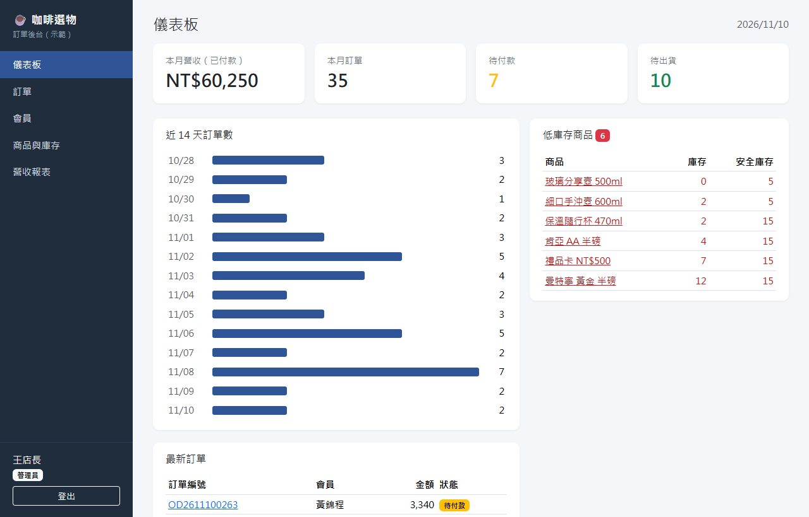
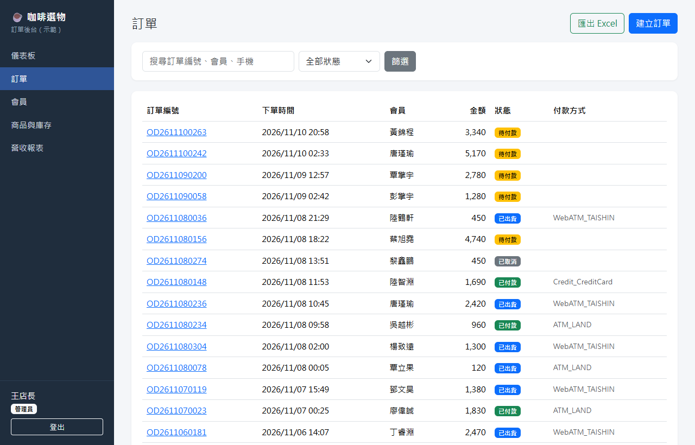
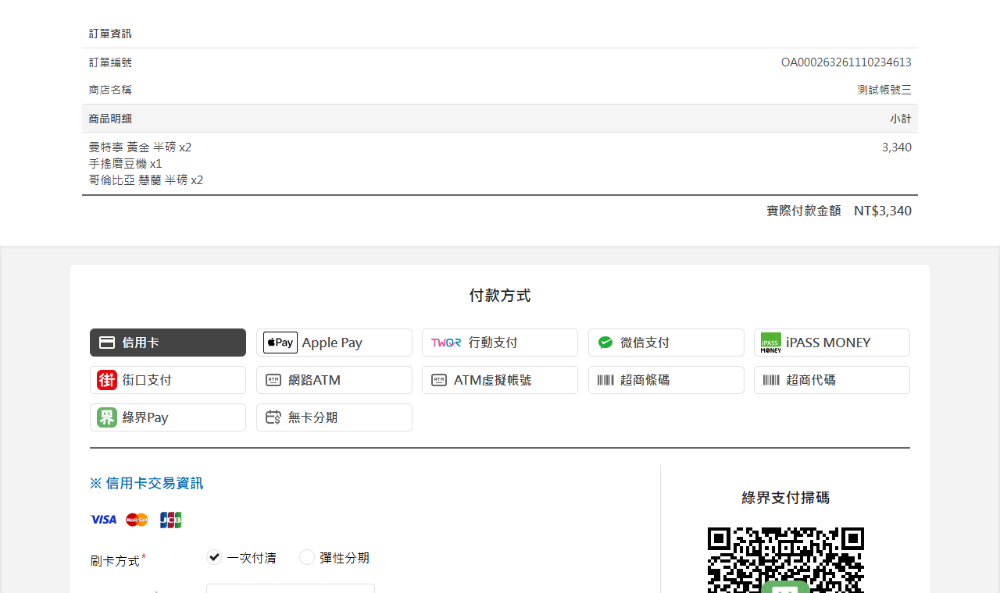
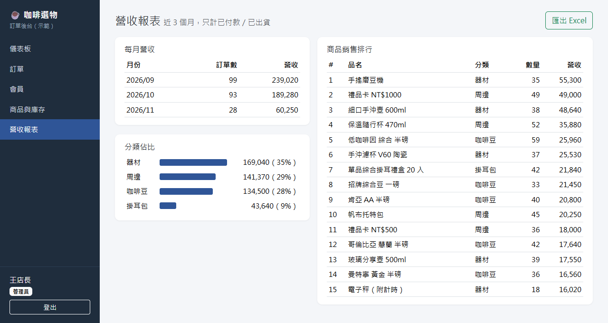
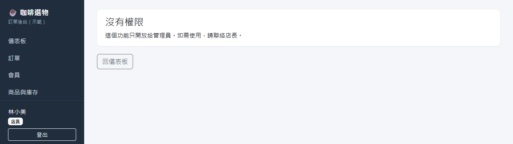
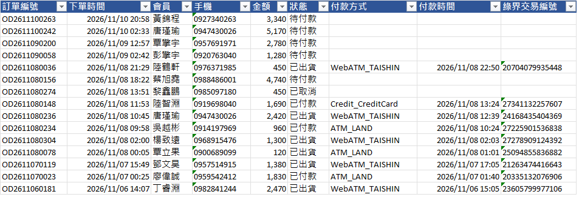
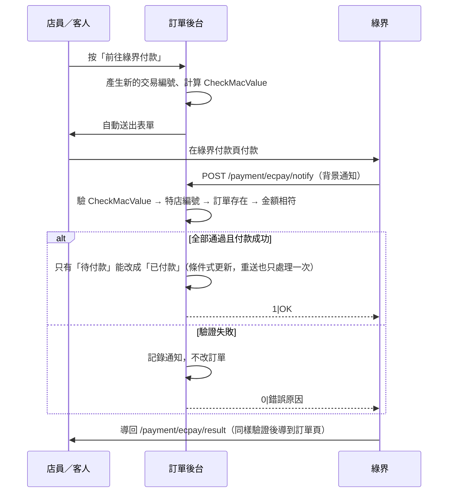

# order-admin-demo：訂單後台＋綠界金流

[](https://github.com/Marc-YULIN/order-admin-demo/actions/workflows/ci.yml)  

ASP.NET Core (.NET 10) order admin demo: login with roles, members / products / orders, Excel export, and ECPay (綠界) payment integration with CheckMacValue verification.

用 ASP.NET Core 做的小型電商訂單後台示範：會員、商品庫存、訂單管理，串接**綠界金流（測試環境）**，付款結果驗證後自動更新訂單狀態。示範店家是虛構的「咖啡選物」，所有資料都是程式產生的假資料。

## 解決什麼問題

- 訂單、會員、庫存分散在 Excel 和 LINE 對話裡，對帳和出貨常常漏掉
- 套裝電商平台功能太多、月費高，又不符合自己的流程
- 想在自己的網站收款，但不確定金流串接怎麼做才安全

這個後台把**下單 → 付款 → 出貨**串成一條線：建立訂單時自動扣庫存，客人在綠界付款後，系統驗證綠界的通知才把訂單改成已付款。

## 畫面

**儀表板**：本月營收、待付款、待出貨、低庫存一眼看完（店員看不到營收）



**訂單列表**：依狀態篩選、搜尋，可匯出 Excel



**送到綠界測試環境**：表單參數與 CheckMacValue 由後台產生，綠界接受後顯示訂單金額與品項



**營收報表**（只有管理員能看）與**權限控管**（店員直接輸入網址也會被擋）





**匯出的 Excel**：標題列凍結、可篩選，中文欄寬自動調整



## 功能

| 功能 | 說明 |
|---|---|
| 登入與權限 | Cookie 登入；管理員、店員兩種角色。所有頁面預設需要登入，營收報表、刪除資料、修改售價只開放管理員，**伺服器端檢查**，不只是隱藏按鈕 |
| 會員 | 新增、編輯、搜尋、分頁；有訂單的會員不能刪除（保留交易紀錄） |
| 商品與庫存 | 低於安全庫存標紅並列在儀表板；店員能調庫存，但改不了售價 |
| 訂單 | 建立訂單時先檢查全部品項庫存，足夠才一次扣除；取消待付款訂單會把庫存加回；狀態只能 待付款 → 已付款 → 已出貨 |
| 綠界金流 | 產生 AIO 付款表單、驗證付款通知（ReturnURL）與付款完成頁（OrderResultURL） |
| 匯出 Excel | 會員、商品、訂單、營收報表都能匯出（ClosedXML） |

## 綠界金流的處理流程



幾個容易出錯、這裡有處理的地方：

- **CheckMacValue**：依綠界文件排序、URL encode、轉小寫後 SHA256，用官方文件的範例做單元測試；比對時用固定時間比較。
- **金額要再核對一次**：簽章正確但金額和訂單不同也拒絕。
- **重複通知**：綠界沒收到 `1|OK` 會重送；用「只有待付款才更新」的條件式更新，兩個通知同時到也只會成功一次。
- **模擬付款**：綠界後台的模擬付款會帶 `SimulatePaid=1`，不是真的收到錢，所以不改狀態。
- **付款完成頁**：綠界把瀏覽器 POST 回來時不會帶登入 cookie（SameSite），所以先驗證再轉成一般 GET 回到訂單頁。
- **每筆通知都留紀錄**，訂單頁看得到，方便對帳。

## 執行方式

需要 [.NET 10 SDK](https://dotnet.microsoft.com/download)。

```bash
dotnet run --project src/OrderAdminDemo
```

開啟 `http://localhost:5059`。第一次啟動會在 `src/OrderAdminDemo/App_Data/` 建立 SQLite 資料庫並產生示範資料（60 位會員、24 項商品、約 320 筆訂單）。

| 示範帳號 | 密碼 | 角色 |
|---|---|---|
| `admin` | `Demo@Admin1` | 管理員 |
| `staff` | `Demo@Staff1` | 店員 |

> 示範帳號只用於本機展示。正式使用請改成由管理員建立帳號，並移除示範資料。

### 綠界測試環境

金鑰不寫進程式或設定檔，用 user-secrets 設定。以下是[綠界官方文件](https://developers.ecpay.com.tw/?p=2856)公開的測試商店值，只能用在測試環境：

```bash
dotnet user-secrets set "Ecpay:MerchantId" "3002607" --project src/OrderAdminDemo
dotnet user-secrets set "Ecpay:HashKey" "pwFHCqoQZGmho4w6" --project src/OrderAdminDemo
dotnet user-secrets set "Ecpay:HashIv" "EkRm7iFT261dpevs" --project src/OrderAdminDemo
```

- 付款頁可用綠界文件提供的測試信用卡，不會實際扣款。
- 綠界的背景通知（ReturnURL）打不到 `localhost`。要完整測試，用 [dev tunnel](https://learn.microsoft.com/azure/developer/dev-tunnels/) 或 ngrok 對外，再設定 `Ecpay:PublicBaseUrl` 為對外網址。本機時，付款完成頁仍會導回並更新狀態。
- 正式上線：換成正式商店的金鑰，並把 `Ecpay:CheckoutUrl` 改成 `https://payment.ecpay.com.tw/Cashier/AioCheckOut/V5`。

### 測試

```bash
dotnet test
```

28 個測試，包含：

- CheckMacValue 與官方範例相同、竄改任一欄位會失敗
- 模擬綠界通知：合法通知改成已付款、重送只處理一次、竄改金額／金額不符被拒絕、模擬付款不改狀態
- 權限（WebApplicationFactory 整合測試）：未登入導向登入頁、店員看營收報表回 403、店員直接送刪除請求被擋、店員改售價被忽略、登入後不會被導到外部網址
- 庫存：建立訂單扣庫存、庫存不足整筆不成立、取消加回庫存

## 專案結構

```
src/OrderAdminDemo/
  Data/              資料表（EF Core）、示範資料
  Services/          訂單狀態與庫存、Excel 匯出、分頁
  Services/Ecpay/    CheckMacValue、付款表單、通知驗證
  Pages/             Razor Pages（儀表板、會員、商品、訂單、報表、登入）
tests/OrderAdminDemo.Tests/
```

資料庫用 SQLite，clone 下來就能跑；換成 SQL Server 只要改 `UseSqlite` 與連線字串。

## 可以客製成什麼服務

- **小型電商／接單後台**：會員、訂單、庫存、出貨管理，依你的流程設計欄位與狀態
- **金流串接**：綠界、藍新等金流，含付款通知驗證、對帳紀錄、退款流程
- **門市／工作室內部系統**：預約、課程、維修單、請款單等，取代多份 Excel
- **權限與報表**：依角色開放功能、營收與商品報表、定期匯出 Excel

## 授權

MIT License
